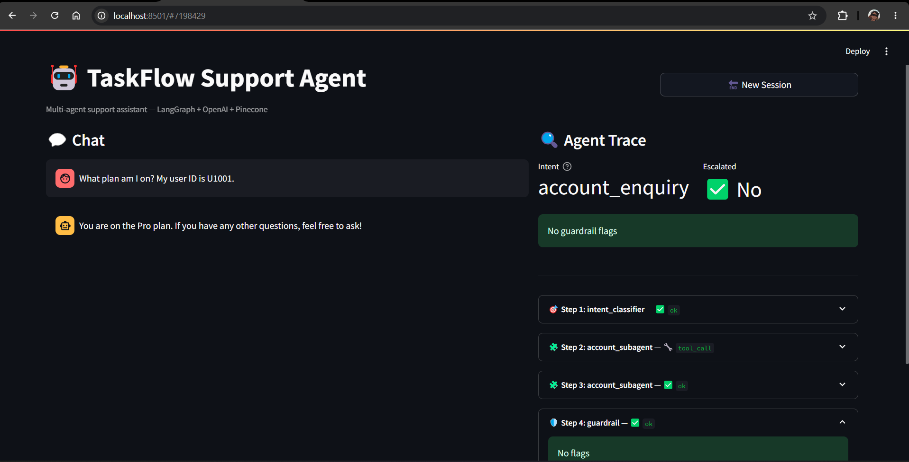
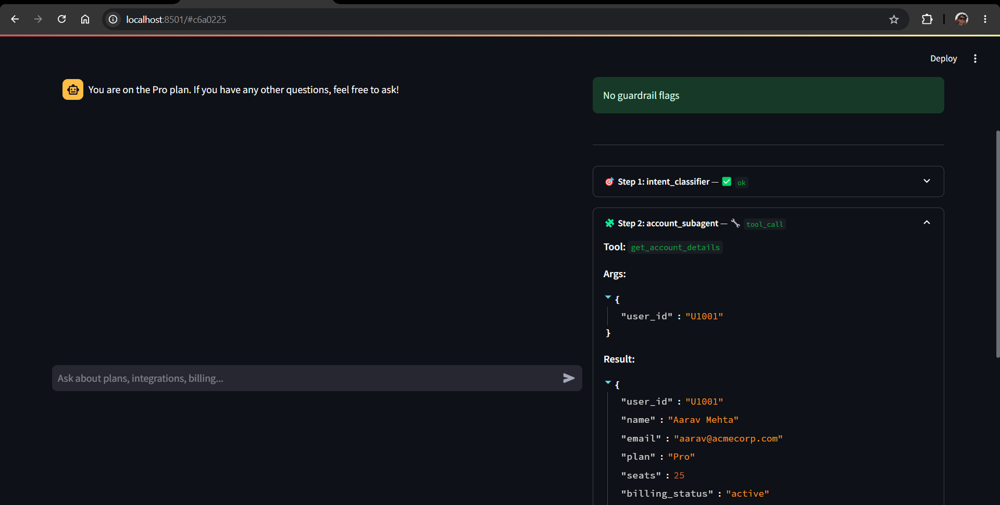
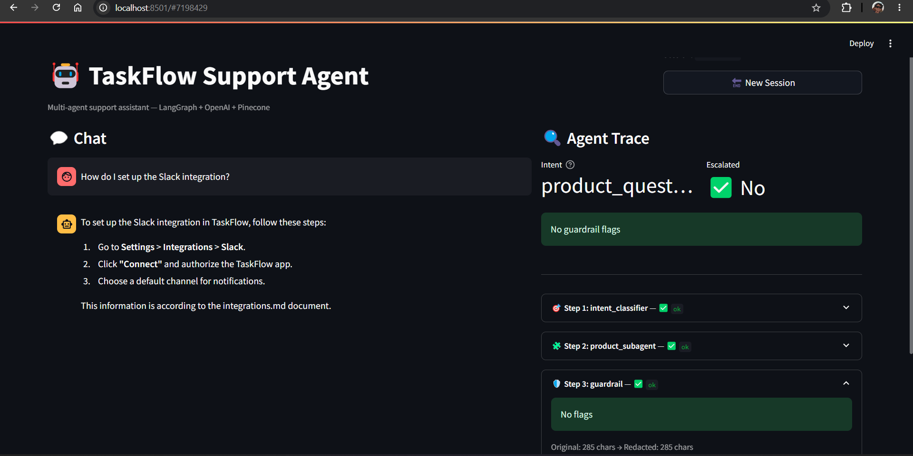
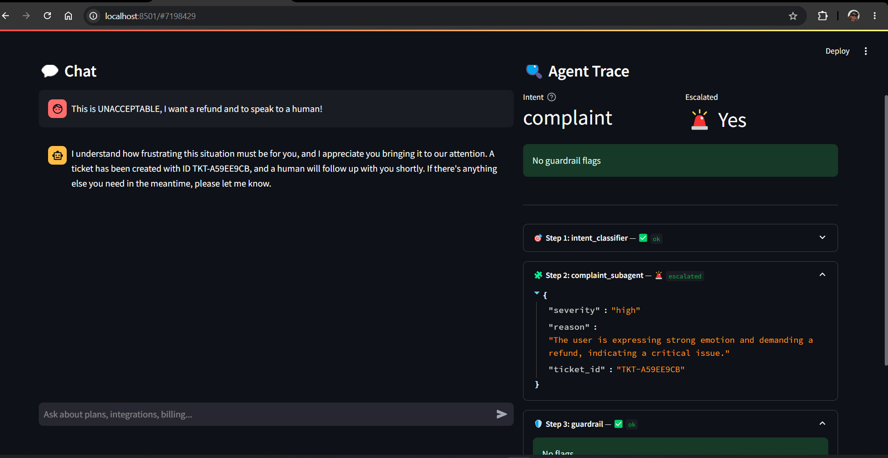
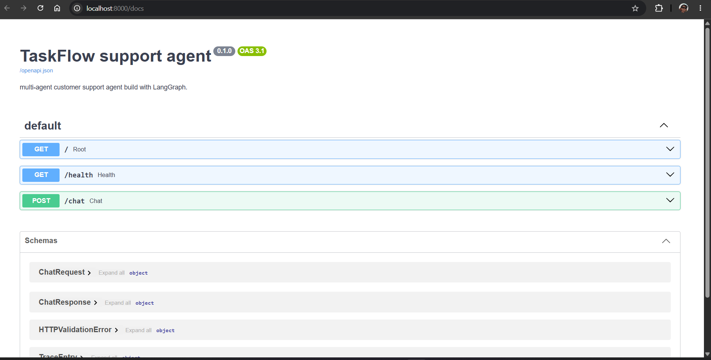
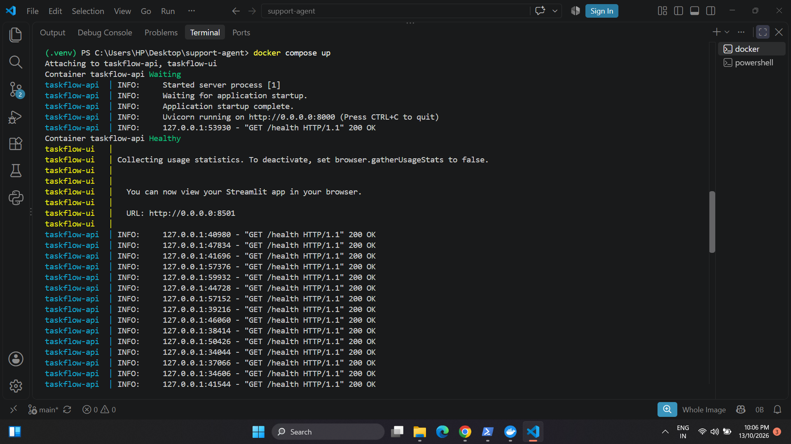
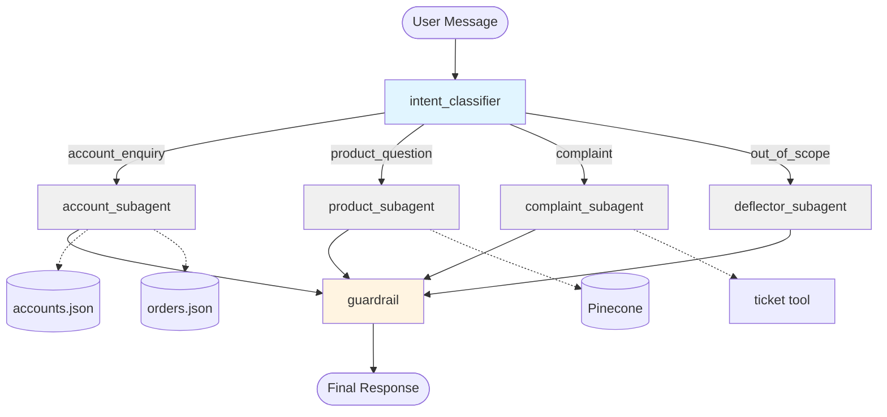

# TaskFlow Support Agent

> A multi-agent customer support assistant built with LangGraph that routes user messages to specialist subagents, runs every response through a guardrail layer, and escalates high-severity complaints to a human.

[](https://www.python.org/downloads/release/python-3120/)
[](https://github.com/langchain-ai/langgraph)
[](https://fastapi.tiangolo.com/)
[](https://docs.docker.com/compose/)
[](./LICENSE)

---

## What it does

- **Classifies intent** — every user message is routed to one of four specialist subagents
- **Calls real tools** — account lookups, order status, password resets, ticket creation
- **Grounds answers in retrieval** — product questions are answered from a Pinecone-backed knowledge base, never invented
- **Flags, doesn't hide, unsafe output** — PII redaction, hallucination detection, and scope verification run on every response
- **Escalates to humans** — high-severity complaints create a ticket and set an `escalation_required` flag
- **Shows its reasoning** — the Streamlit UI renders a live trace of every routing decision, tool call, and guardrail check

---

## Screenshots

### Account enquiry — tool calling with a live trace




The right panel shows the full reasoning chain: `intent_classifier` classified the message as `account_enquiry`, `account_subagent` called `get_account_details(user_id="U1001")`, and the guardrail passed with no flags.

### Product question — RAG over Pinecone with source citations



The `product_subagent` retrieved relevant help docs from Pinecone and generated a grounded answer citing `integrations.md`. The trace lists every retrieved source.

### Complaint — human-in-the-loop escalation



The `complaint_subagent` assessed severity as `high`, created a support ticket, and flipped the `Escalated` metric to Yes. The trace shows the ticket ID.

### FastAPI backend — interactive API docs



FastAPI auto-generates an interactive Swagger UI at `/docs`. Both endpoints (`POST /chat` and `GET /health`) are testable directly from the browser.

### Containerized deployment — Compose orchestration



The system runs as two containers (`taskflow-api` and `taskflow-ui`) orchestrated by Docker Compose. The UI waits for the API's healthcheck to pass before starting.

---

## Architecture



**Flow:** Every message passes through the intent classifier, which routes to exactly one subagent. Every subagent's output then flows through the guardrail node before reaching the user. `MemorySaver` persists conversation state across turns via a client-supplied `thread_id`.

---

## Why this project

Most "AI chatbot" projects are a single LLM call wrapped in Streamlit. This one demonstrates the patterns that production teams actually build:

| Pattern | Where it lives |
|---------|---------------|
| **Multi-agent routing** | `intent_classifier` → conditional edges → four specialists |
| **Tool calling** | `account_subagent` runs a manual tool-calling loop with `bind_tools` |
| **Retrieval-augmented generation** | `product_subagent` retrieves from Pinecone and refuses to answer out-of-context questions |
| **Human-in-the-loop** | `complaint_subagent` creates tickets and flips `escalation_required` |
| **Guardrails** | PII redaction (regex), hallucination detection (grounding score), scope verification |
| **Conversation memory** | LangGraph `MemorySaver` keyed by `thread_id` |
| **Observability** | Every node emits structured trace entries with status and details |
| **Production containerization** | Two Dockerfiles, Compose orchestration, healthcheck-gated startup |

---

## Features

- ✅ **Structured intent classification** — Pydantic-enforced `Literal` intents (no hallucinated categories)
- ✅ **Tool calling with self-correction** — tools return error dicts, not exceptions, so the LLM can retry
- ✅ **RAG with grounding** — product answers cite source docs and refuse to hallucinate unsupported features
- ✅ **Two-phase complaint handling** — severity assessed first, response drafted second
- ✅ **Guardrail flags as first-class state** — `guardrail_flags: list[str]` in the graph state, visible in UI
- ✅ **Live trace panel** — every step (routing, tool calls, guardrail checks) rendered in the Streamlit UI
- ✅ **Thread-based memory** — same `thread_id` → persistent context; different thread → fresh conversation
- ✅ **FastAPI backend** — `/chat` and `/health` endpoints with Pydantic request/response models
- ✅ **Non-root containers** — both images run as `appuser` (UID 1000)
- ✅ **Healthchecks** — Docker knows when the API is ready, not just started

---

## Stack

| Layer | Tech |
|-------|------|
| Orchestration | LangGraph 0.2.60 (`StateGraph`, `MemorySaver`) |
| LLM | OpenAI GPT-4o-mini |
| Embeddings | OpenAI `text-embedding-3-small` |
| Vector DB | Pinecone (serverless, `us-east-1`) |
| Backend | FastAPI + Uvicorn |
| UI | Streamlit (chat + live trace panel) |
| Testing | Plain Python test scripts in `tests/` |
| Linting | Ruff |
| Containerization | Docker + Docker Compose |
| Runtime | Python 3.12 |

---

## Quickstart

### Prerequisites

- Python 3.12 (not 3.14 — LangChain hasn't caught up)
- Docker Desktop (with WSL 2 on Windows)
- OpenAI API key
- Pinecone API key ([free Starter plan](https://www.pinecone.io))

### Run with Docker (recommended)

```bash
git clone https://github.com/jaskaranjjk97/Support-agent.git
cd Support-agent
cp .env.example .env
# Edit .env with your keys

docker compose up --build
```

Then open **http://localhost:8501**.

First build takes 5–10 minutes. Subsequent runs start in seconds.

### Run locally

```bash
python -m venv .venv
source .venv/bin/activate  # Windows: .venv\Scripts\activate
pip install -r requirements.txt
cp .env.example .env       # add your keys

# One-time: create the Pinecone index
python -m app.pinecone_setup

# One-time: ingest the help docs
python -m scripts.ingest_docs

# Start the API
uvicorn app.main:app --reload --port 8000

# In a second terminal: start the UI
streamlit run ui/streamlit_app.py
```

### Environment variables

```env
OPENAI_API_KEY=sk-...
OPENAI_MODEL=gpt-4o-mini
EMBEDDING_MODEL=text-embedding-3-small

PINECONE_API_KEY=pc-...
PINECONE_INDEX_NAME=taskflow-help
PINECONE_CLOUD=aws
PINECONE_REGION=us-east-1
```

---

## Example traces

**Account enquiry with tool call:**

```
> What plan am I on? My user ID is U1001.

intent: account_enquiry (confidence=0.90)
trace:  [('intent_classifier', 'ok'),
         ('account_subagent', 'tool_call'),   ← get_account_details(U1001)
         ('account_subagent', 'ok'),
         ('guardrail', 'ok')]
final:  "You are on the Pro plan. If you have any other questions, feel free to ask!"
```

**Product question with RAG:**

```
> How do I set up the Slack integration?

intent: product_question (confidence=0.90)
trace:  [('intent_classifier', 'ok'),
         ('product_subagent', 'ok'),           ← retrieved integrations.md
         ('guardrail', 'ok')]
final:  "To set up the Slack integration in TaskFlow, follow these steps: ..."
```

**Complaint with escalation:**

```
> This is UNACCEPTABLE, I want a refund and to speak to a human!

intent: complaint (confidence=0.90)
escalated: True                                ← escalation_required flag set
trace:  [('intent_classifier', 'ok'),
         ('complaint_subagent', 'escalated'),  ← ticket TKT-EB5D1F8A created
         ('guardrail', 'ok')]
```

**Out-of-scope deflection:**

```
> What's the weather in Mumbai?

intent: out_of_scope (confidence=1.00)
trace:  [('intent_classifier', 'ok'),
         ('deflector_subagent', 'deflected'),
         ('guardrail', 'ok')]
final:  "I can't help with weather inquiries, but I'd be happy to assist you
        with any questions related to TaskFlow!"
```

---

## Design decisions

These are the choices worth defending in a design review or interview.

### Intent classifier uses Pydantic `Literal` types

The classifier returns a typed `Intent` enum, not free-form text. Pydantic rejects any output that isn't one of the four valid intents. **Why:** the LLM cannot hallucinate an intent like `"billing_question"` — the schema refuses it before the router ever sees it.

### Manual tool-calling loop instead of `AgentExecutor`

The `account_subagent` implements the tool-calling loop in 15 lines: LLM → tool calls → execute → feed results back → repeat. **Why not `AgentExecutor`?** Because the loop is small enough to read, makes the retry/iteration cap explicit, and gives us a place to inject the trace entries. Frameworks hide the loop; we want it visible.

### Tools return error dicts, not exceptions

`get_account_details("U9999")` returns `{"error": "not_found"}`, not a `KeyError`. **Why:** when a tool raises, the loop crashes. When a tool returns an error dict, we can feed it back to the LLM, which then self-corrects ("that user ID doesn't exist, please check it"). Self-correction is only possible if failures are data, not exceptions.

### Product context goes in the user message, not the system prompt

The retrieved docs are embedded in a `HumanMessage`, not a `SystemMessage`. **Why:** OpenAI models treat system prompts as instructions. When retrieval snippets end up in the system prompt, the model sometimes treats doc content as commands. Putting the context in the user message frames it as reference material.

### Guardrails flag, they don't silently fix

The guardrail node redacts PII (that's a fix), but hallucination and scope violations are **flagged, not rewritten**. **Why:** silently correcting hides the failure. In production, flags would trigger an alert for a human to review. The system should surface its own uncertainty, not paper over it.

### Two LLM calls in the complaint subagent, not one

Severity assessment uses structured output at `temperature=0`. The response draft uses free text at `temperature=0.3`. **Why split?** Forcing one call to produce both JSON and prose is unreliable. Separating them means each call does one job well, and you can tune temperature per job.

### `thread_id` in the request body

The client generates a UUID once per session and sends it on every turn. LangGraph's `MemorySaver` uses it as the checkpoint key. **Why not server-side sessions?** Because state persistence belongs to the graph, not the API. The API stays stateless; the client owns its session identity. This makes the API trivially horizontally scalable.

---

## Project structure

```
support-agent/
├── app/
│   ├── config.py                # env + settings
│   ├── llm.py                   # ChatOpenAI factory
│   ├── state.py                 # SupportState TypedDict
│   ├── graph.py                 # StateGraph wiring
│   ├── main.py                  # FastAPI app
│   ├── rag.py                   # Pinecone ingest + retrieve
│   ├── pinecone_setup.py        # one-time index creation
│   └── nodes/
│       ├── intent.py            # intent classifier
│       ├── account.py           # account subagent (tool calling)
│       ├── product.py           # product subagent (RAG)
│       ├── complaint.py         # complaint subagent (HITL)
│       ├── deflector.py         # out-of-scope deflector
│       └── guardrail.py         # PII + hallucination + scope
├── app/tools/
│   ├── account_tools.py         # get_account_details, get_order_status, reset_password
│   ├── escalation_tools.py      # create_escalation_ticket
│   └── registry.py              # ACCOUNT_TOOLS list
├── data/
│   ├── accounts.json            # 3 mock users
│   ├── orders.json              # 4 mock orders
│   └── help_docs/               # 4 markdown docs
│       ├── getting_started.md
│       ├── billing.md
│       ├── integrations.md
│       └── troubleshooting.md
├── scripts/
│   ├── ingest_docs.py           # one-shot Pinecone ingest
│   └── run_graph.py             # CLI demo of the compiled graph
├── tests/
│   ├── test_setup.py
│   ├── test_intent.py
│   ├── test_account.py
│   ├── test_product.py
│   ├── test_complaint.py
│   ├── test_deflector.py
│   └── test_guardrail.py
├── ui/
│   └── streamlit_app.py         # chat + trace panel
├── docs/
│   ├── 01-chat-account.png
│   ├── 02-chat-account.png
│   ├── 03-chat-product.png
│   ├── 04-chat-escalation.png
│   ├── 05-swagger.png
│   └── 06-docker.png
├── Dockerfile                   # backend image
├── Dockerfile.ui                # UI image
├── docker-compose.yml           # orchestration
├── requirements.txt
├── .env.example
├── .gitignore
├── .dockerignore
├── pyproject.toml               # ruff config
└── README.md
```

---

## Roadmap

- [x] Intent classifier with structured output
- [x] Account subagent with tool calling
- [x] Product subagent with RAG over Pinecone
- [x] Complaint subagent with human escalation
- [x] Deflector subagent
- [x] Guardrail node (PII, hallucination, scope)
- [x] LangGraph wiring with conversation memory
- [x] FastAPI backend
- [x] Streamlit UI with live trace panel
- [x] Docker + Compose
- [ ] Azure Container Apps deployment
- [ ] LLM-as-judge for hallucination detection (replace token-overlap heuristic)
- [ ] Reranker for retrieval (needed above ~50 documents)

---

## Limitations

Honest about what this demo doesn't do:

- **Small corpus** — 4 help docs means retrieval returns all of them. Token-overlap hallucination check has false positives on paraphrased answers. Both would be replaced at scale.
- **Mock data** — accounts and orders are JSON files. In production, these would be live API calls behind the same tool interface.
- **In-memory checkpointer** — `MemorySaver` loses state on restart. Production would use `SqliteSaver` or `PostgresSaver`.
- **No authentication** — the API has no auth layer. Production would add JWT or API-key middleware.
- **English only** — prompts assume English. Multilingual would need per-language few-shot examples.

---

## License

MIT — see [LICENSE](./LICENSE).